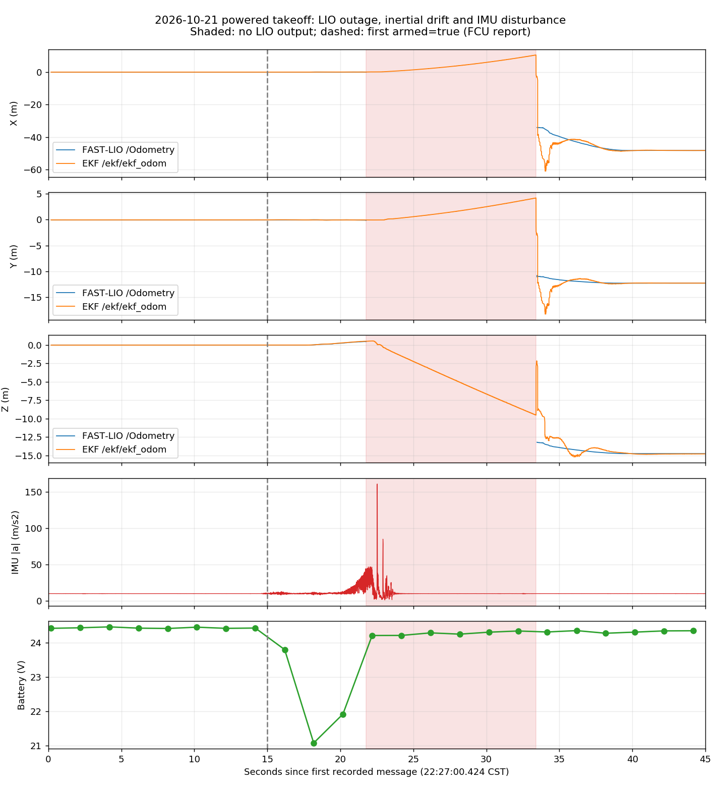

# 2026-10-21：起飞时定位发散，手持运动正常

## 1. 当前结论

本次离线读取新 bag、录包参数快照及同次 Livox/FAST-LIO/EKF 日志，没有启动节点、回放或发送控制命令，也没有修改飞控、控制器、外参或时间同步参数。

**优先排查雷达供电、接插件及雷达端复位，而不是先修改 TF 或规划参数。**
三次异常飞行的 Livox 日志均出现数秒收包日志空白，随后收到的雷达状态推送序号从大值回到 `70`。
这与雷达端重启或固件/链路复位高度一致，但日志没有直接记录“欠压复位原因码”，因此不能认定已经证明某个 DC-DC 损坏。
新包同时记录到起飞负载下的大幅 IMU 波动，振动、机械松动、冲击和闭环控制激发需并行检查。

已确认的软件问题是：LIO 中断期间，后级 EKF 仍惯性传播并持续输出；PX4Ctrl 仅检查后级消息接收新鲜度，不能据此判断上游 LIO 约束仍然有效。
这会放大传感器中断的后果，但不是雷达为何复位的解释。

## 2. 分析了哪些包

以下时间均为北京时间（UTC+8）；目录名是录包脚本启动时间，不是 bag 第一条消息时间。

| 包目录（`~/flight_logs/` 下） | 本次用途 | 直接证据 |
|---|---|---|
| `20261021_222647_debug/flight_0.bag` | 最新已封口分片中的异常起飞 | 第一次解锁在相对 15.011 秒；LIO 停更 11.616 秒；雷达状态序号回退 |
| `20261021_221944_debug/flight_0.bag` | 未解锁、有多次上下移动的对照 | 全程 armed=false；LIO z 约 0.054～1.252 米并回落，无秒级中断；不能仅凭 bag 确认操作者动作，符合用户所述手持测试 |
| `20261021_215623_debug/flight_0.bag` | 另一次异常起飞的复现对照 | LIO 停更 12.469 秒，雷达状态序号也回退 |
| `20261021_223213_debug/flight_0.bag` | 更晚的静止短录包 | 全程未解锁、位置近似静止；没有起飞，不能用作飞行正常证据 |
| `20261021_210844_debug/flight_0.bag` | 前次分析的回溯核查 | 原先发现 LIO 停更；现补查到同次驱动日志也有序号回退 |

`222647` 录制跨越后续节点停启，本报告的起飞结论限于第一段相对 0～62 秒，不把后面定位原点重置混入飞行漂移。
读取时 `flight_0.bag` 已封口，但同目录仍有后续分片；没有停止用户录包器，也没有 reindex 原文件。
曾对 `.active` 的 `/tmp` 副本尝试恢复索引，最终统计使用已封口的原始 `flight_0.bag`。

## 3. 最新异常起飞的时间线

`222647/flight_0.bag` 第一条消息：**2026-10-21 22:27:00.424**。
下表相对时间采用 bag 接收时间；位置来自消息字段，不经过 RViz/TF。

| 相对秒数 | 事件 |
|---|---|
| 0～14 | 未解锁，IMU 加速度模长均值约 9.809 m/s²，标准差约 0.025 m/s² |
| 15.011 | MAVROS 首次报告 armed=true、OFFBOARD |
| 18.176 | 电池话题采样约 21.071 V，起飞前约 24.4 V；这是电池端低频遥测，不是雷达端电压测量 |
| 20～21 | IMU 加速度模长标准差升至约 2.891 m/s² |
| 21～21.769 | 模长均值约 24.278、标准差约 7.826、最大约 44.383 m/s²；已经发生在最后一帧 LIO 之前 |
| 21.769 | 最后一帧连续 LIO，xyz 约 `(0.024, -0.128, 0.476)`；绝对时间 22:27:22.193 |
| 22.123 | 起飞脚本因 CH5/CH6 未同时满足阈值而退出；本包没有 `/goal` 或 `/setpoints_cmd` 消息 |
| 22～23 | IMU 出现最大约 161.113 m/s²、最大角速度模长约 7.552 rad/s；这些峰值在 LIO 停更之后，不能倒置为最初断流原因 |
| 28.012 | MAVROS 报告 armed=false；不凭这条状态认定此前已安全落地 |
| 33.385 | LIO 恢复，距离上一帧 **11.616 秒**；第一帧恢复数据的 header 已落后接收时刻约 **8.664 秒** |
| 恢复前 | EKF 已漂移到约 `(10.497, 4.184, -9.497)`，并非真实飞行位置的证明 |
| 约 40 | LIO/EKF 数值都在约 `(-48, -12, -15)` 附近；二者再次接近不能证明定位恢复正确 |

LIO 中断区间内仍记录到 **1976 条 EKF 输出**，相邻 EKF 接收间隔最大约 0.077 秒。
在第一段 0～62 秒，MAVROS 原始 IMU header 未倒退、未重复，最大步长约 0.027 秒；这不支持“IMU 完全断了十几秒”的解释。
LIO 中断前同时刻数值配对位置差 p95 约 0.027 米；这只说明中断前两路数值接近，并非绝对精度认证。



图中红色背景表示 LIO 没有输出的区间；虚线是首次 armed=true。蓝线不会跨越 LIO 空白区间强行插值。

## 4. 为什么现在优先查雷达供电和复位

对应日志均位于 `~/gcs_ws/log/`：

| 启动目录 | 中断前雷达状态推送 | 恢复后的雷达状态推送 | 日志间隔 |
|---|---|---|---|
| `fastlio2_ekf_20261021_210719` | 21:09:07.373，Seq 9537 | 21:09:13.675，Seq 70 | 6.302 秒 |
| `fastlio2_ekf_20261021_214717` | 21:56:42.942，Seq 20354 | 21:56:50.973，Seq 70 | 8.031 秒 |
| `fastlio2_ekf_20261021_222437` | 22:27:21.753，Seq 7015 | 22:27:28.455，Seq 70 | 6.702 秒 |

最新日志的原始行见 `fastlio2_ekf_20261021_222437/livox_driver.log` 第 327、329 行。
这两行之间还存在设备发现消息的空白。**状态推送收包中断不等同于已经直接测量到原始点云断流**，但与 LIO 中断同时出现，且序号回到相同低值，证据比单纯“有效点不足”更靠近设备侧。

本机 SDK `~/Livox-SDK2/sdk_core/command_handler/mid360s_command_handler.cpp` 第 62～87 行显示，日志打印的是接收报文的 `command.packet.seq_num`；
`sdk_core/comm/define.h` 将 `0x0102`（十进制 258）定义为雷达状态推送。
这些大值到 70 的变化不符合该时段每秒约 26 增量下的正常 16 位回绕。
没有看到同一日志中再次出现完整驱动初始化序列，**倾向雷达端复位，而不是单纯 ROS 驱动进程重启**；原因仍可能涉及供电、插头瞬断、设备固件或链路问题。

手持对照包中全程未解锁，有正常上下移动，LIO/EKF 725 组数值配对位置差 p95 约 0.058 米，最大约 0.090 米；相应驱动日志未见上述序号回退。
因此“手拿正常、带桨起飞异常”不能排除负载下供电跌落或振动导致的连接故障。

## 5. 各候选原因的优先级和边界

1. **高优先级：雷达电源/接插件及雷达端复位。** 有三次重复序号回退证据，但没有雷达端电压波形或复位原因码。检查雷达供电是否与大电流负载共用薄弱 DC-DC、接插件松动、线束被振动拉扯；由有经验人员检查电压、电流能力和保护策略，不盲目改接电源。
2. **高优先级：机械振动或不正常运动。** 起飞前后的 IMU 统计相差很大。检查桨、电机、机臂、飞控减振、雷达固定及线束。仅凭这些低频 ROS IMU 数据不能区分高频振动混叠、IMU 削顶、控制振荡、翻转或撞击；要补 PX4 ULog。
3. **已证软件保护不足：LIO 失效后 EKF 仍输出。** EKF IMU 回调继续传播，PX4Ctrl 检查后级接收时间；还需验证 LIO 新鲜度、观测是否真正被融合以及定位健康。不要简单放大 EKF 的 0.3 米门限来强行接受已失真的数据。
4. **仍需核查但非首要：时间轴/外参及运行负载。** FAST-LIO 将 IMU 时间戳减去 `-0.068406` 秒，而后级 EKF 直接消费另一条 IMU 原始时间轴；需离线统一物理时刻核查，不能靠静态平移验证。当前还启用了每 100 帧同步保存 PCD，可能增加处理延迟，但没有证据证明它造成这次设备序号回退。
5. **不是当前主证据指向：单纯 RViz、TF 或规划器。** 发散已存在于存储的位置字段；最新异常飞行没有目标或位置轨迹指令。缺失真实 `camera_init ↔ world` TF 的接口问题仍需处理，但加单位 TF 不能修复这次定位故障。

## 6. 下一步：先地面取证，不再用自动起飞试错

- 先暂停自动起飞；不要手持带桨机测试，不在手边解锁排查。机械、电源和连接检查先断电、拆桨，由熟悉硬件的人执行。
- 最关键是检查**雷达插头处**的电源稳定性；电池话题 21.071 V 只是关联证据，不能证明雷达输入端电压正常或异常。必要时由专业人员测量瞬态电压和设备复位状态。
- 导出对应飞行的 **PX4 `.ulg`**，检查 IMU vibration/clipping、传感器切换、实际姿态/角速度、电机输出和故障事件；ROS bag 没有这些完整的机内诊断量。
- 下次地面记录必须加 `--raw-lidar`，同步保存 `/livox/lidar` 与 `/livox/imu`。本次几段 bag 的此选项均未开启，因此原始点数、逐点时间及雷达内置 IMU 的断流时间无法从包中补回。
- 地面手持测试应只运行感知链，不需要 PX4Ctrl、起飞脚本或规划目标。拆桨空载电机检查也不能证明带桨负载下电源足够，不据此直接恢复自动飞行。

```bash
source ~/gcs_ws/devel/setup.bash
python3 ~/gcs_ws/src/Diff-Planner/src/diff_planner/plan_manage/scripts/record_diff_planner_debug.py \
  --raw-lidar \
  --duration 90
```

命令仅录制/查询，不解锁、不切模式、不发目标；默认保存到新的 `~/flight_logs/时间_debug/`，不依赖 `$FLIGHT_DIR`。
结束后保留完整录包目录、同次 `fastlio2_ekf_*` 日志和 ULog；不要只复制一张 RViz 截图。

## 7. 诊断工具和证据

离线工具现在同时检查“LIO 在包末停止”和“LIO 在包中停止后恢复、期间 EKF 仍连续输出”，避免恢复后只看误差中位数而漏报中途失效。
共同停机/重启造成的两路空白不会误报为“EKF 持续发布”。0.5 秒只是排查阈值，不是飞行安全门限。
本次 25 项离线单元测试通过，其中新增了恢复后仍告警、两路共同中断不误报两项测试。

```bash
source ~/gcs_ws/devel/setup.bash
python3 ~/gcs_ws/src/Diff-Planner/src/diff_planner/plan_manage/scripts/analyze_diff_planner_frames.py \
  ~/flight_logs/20261021_222647_debug/flight_0.bag \
  --params ~/flight_logs/20261021_222647_debug/runtime_all.yaml \
  --output /tmp/frame_audit_222647_review.json
```

输出路径必须是新文件；工具不会启动 ROS 或发布消息。
本次紧凑证据为 `docs/evidence/powered_takeoff_evidence_20261021.json`，完整帧审计为 `docs/evidence/frame_audit_20261021_222647.json`。
